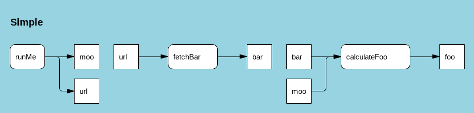
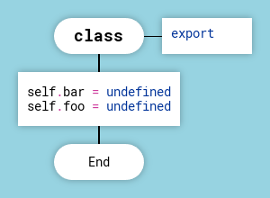
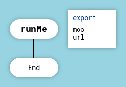
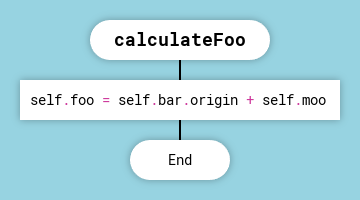

# Jacy

## What Is Jacy?

Jacy is a compiler and runtime for JavaScript that automatically connects independent functions into an executable program based on their shared-data dependencies.

You write functions in the usual imperative style. Jacy connects them based on which shared variables these functions read and write.

**Jacy's goal is to free you from unnecessary function calls.**

Jacy is inspired by Enn Tõugu’s work on conceptual programming.

## Example

You write two independent functions:

```javascript
function calculateFoo() {
    self.foo = self.bar.origin + self.moo;
}

async function fetchBar() {
    const response = await fetch(self.url);
    self.bar = await response.json();
}
```

Jacy connects them into an execution sequence equivalent to:

```javascript
async function doWork(moo, url) {
    self.moo = moo;
    self.url = url;

    await fetchBar();
    calculateFoo();
}
```

Jacy understands that:

- `fetchBar()` reads `url` and writes `bar`.
- `calculateFoo()` reads `bar` and `moo`.
- `calculateFoo()` writes `foo`.
- `calculateFoo()` depends on `fetchBar()`.

When you provide values for `moo` and `url`, Jacy executes the relevant functions in the correct order.

The actual implementation is more complex than the example above. Jacy does not necessarily generate a function named `doWork()`. Instead, the compiler generates an execution plan that the runtime uses to invoke the appropriate functions.

Jacy statically analyzes your code and builds a dependency graph. When you assign values to shared input variables, Jacy triggers the dependent functions in the correct order.

Jacy offers an alternative approach to program decomposition.

Instead of manually arranging the function call hierarchy, passing arguments between functions, and handling their return values, you can let Jacy connect your algorithms.

This means writing less orchestration code. More importantly, you can concentrate on the interesting parts of your program—the non-trivial algorithms that form its core.

**Jacy takes care of the boring part: connecting your algorithms.**

## Visualization

The Jacy compiler generates diagrams that show how it connects your functions.

It is appealing to let a program's structure emerge automatically from independent rules. However, understanding the resulting system can become difficult.

Jacy addresses this problem by generating a visual representation of the synthesized program, helping you understand its high-level flow and dependencies.



Jacy generates .free diagrams that can be edited with [the DrakonHub diagram editor](https://drakonhub.com/).

## A Spreadsheet Analogy

Jacy is similar to a spreadsheet.

In a spreadsheet, some cells contain input values, while others contain formulas. Formulas can reference other cells, creating a dependency graph. In a conventional spreadsheet without circular references, this graph is a directed acyclic graph (DAG).

When you change an input cell, the spreadsheet engine recalculates the affected formulas in dependency order.

Jacy works in a similar way.

Instead of cells, you work with shared variables. Jacy extracts dependencies between these variables from your code and builds a dependency graph at compile time.

At runtime, you assign values to input variables, and Jacy executes the affected functions to update the dependent shared variables.

There are several important differences between spreadsheets and Jacy:

- A Jacy function can write to multiple shared variables.
- Jacy functions can have side effects, such as making HTTP requests or writing to a database.
- Jacy functions can contain conditional statements that affect which shared variables are assigned and, consequently, which downstream functions become eligible to run.

## A Trigger Analogy

Programming with Jacy resembles programming with database triggers.

Instead of constructing one large program with an explicit call hierarchy, you write smaller, independent functions. Each function can represent an individual business rule or processing step.

Jacy automatically determines how these functions depend on one another.

There are several differences between conventional database triggers and Jacy:

- **Automatic trigger detection.** You do not need to specify which variable changes should activate a trigger. The Jacy compiler deduces this from the variables the function reads.
- **Cycle detection.** The compiler detects cycles in the trigger dependency graph and reports them as errors.
- **Controlled execution.** The runtime schedules triggers according to their dependencies and avoids executing the same trigger more than once within a single execution plan.
- **Input availability.** The runtime executes a trigger only when all the shared variables it reads have defined values.
- **Visualization.** The compiler generates diagrams showing the triggers and their dependencies.

## Jacy and Prolog

Jacy shares some ideas with Prolog but makes different trade-offs.

Both systems use depth-first traversal, but Jacy marks visited nodes to avoid redundant computations.

Jacy resolves computational dependencies until all the required inputs are available.

Furthermore, Jacy uses ordinary imperative JavaScript functions as its building blocks. That allows developers to reuse existing libraries, perform I/O, and implement complex algorithms in a familiar way.


## How to Use Jacy

Jacy consists of two parts: the compiler and the runtime.

The typical workflow is:

1. Write JavaScript code following the conventions Jacy understands.
2. Run the Jacy compiler to analyze and transform your JavaScript code.
3. Create a Jacy runtime instance and initialize the transformed code with it.
4. Call a public method on one of your objects.
5. Let the runtime execute the dependent triggers automatically.

## Jacy Coding Conventions

Jacy understands JavaScript generated by DrakonTech, but you do not need to use DrakonTech.

You can write JavaScript manually, provided it follows the conventions described below.

### 1. Wrap your code in a module function

The module function contains the definitions of your classes and exports their factory functions.


```javascript
function example04() { // The module function
    var unit = {}; // The module object

    function Simple() { // The class factory function.
        var self = {}; // It is important to use the word "self" to refer to the class instance.
        function calculateFoo() { // A trigger
            self.foo = self.bar.origin + self.moo;
        }
        async function fetchBar() { // A trigger
            const response = await fetch(self.url);
            self.bar = await response.json();
        }
        function runMe(moo, url) { // runMe method. moo an url become input shared variables
        }
        self.runMe = runMe; // runMe method is exported here.
        return self;
    }
    unit.Simple = Simple; // Simple class is exported here.
    return unit; // The module function returns the module object.
}
module.exports = { example04 }; // Export the module function (not necessary in the browser).
```


### 2. Organize your code into classes

Use the factory function pattern to define classes.

Do not use the JavaScript `class` keyword.

Each class is represented by a function that creates and returns an object.

### 3. Shared variables

You do not need to declare shared variables explicitly.

Jacy automatically identifies shared variables:

- from the parameters of public methods;
- from the parameters of constructors;
- from reading and writing to the properties of the `self` object (for example, `self.bar`).

### 4. Define methods and triggers

Each class can contain methods and triggers.

A **method** is an exported function that can be called from outside the object. Its parameters provide input values to the object.

A **trigger** is a private function that reads shared variables. It may also write to shared variables or perform side effects.

Methods initiate calculations by assigning values to shared variables. The runtime then executes the relevant triggers according to their dependencies.

Triggers access shared variables through properties of the `self` object.

## How to Run Your Code with the Jacy Runtime

First, create a Jacy runtime instance:

```javascript
var runtime = TriggerRuntime05();
```

Next, initialize your compiled module, passing the runtime instance:

```javascript
var program04 = example04(runtime);
```

Create an instance of a class exported by the module:

```javascript
var simpleObj = program04.Simple();
```

Call a public method:

```javascript
await simpleObj.runMe(
    "This is my IP.",
    "https://httpbin.org/get"
);
```

The runtime executes the relevant triggers in dependency order.

Finally, read the output variables from the object:

```javascript
console.log("runMe done:", simpleObj.foo);
```

## Async and Await

Jacy supports asynchronous triggers.

If a public method activates an asynchronous trigger, the compiler makes that method asynchronous as well.

For example:

```javascript
await simpleObj.runMe(
    "This is my IP.",
    "https://httpbin.org/get"
);
```

The `await` keyword ensures that the calculation finishes before execution continues.

Jacy handles the asynchronous execution of triggers while preserving their dependency order.

## A Shorthand for One-Off Calculations

The typical Jacy use case is a reusable object with persistent state.

First, you create an object. It can be long-lived, such as a UI widget.

Then, you call a public method. The method assigns input variables and activates the relevant triggers.

The triggers update the object's shared variables and may perform side effects.

You can then read the output variables or use the results of those side effects.

Later, you can call the same method or another method, and the cycle repeats.

### One-off calculations

Sometimes you need to perform a calculation only once.

Instead of creating an object and then calling a method, you can provide the input values directly to the factory function.

Jacy runs the relevant triggers during initialization and returns the object with its output variables populated.

For example:

```javascript
var shorthandObj = await program04.Shorthand(
    "This is my IP.",
    "https://httpbin.org/get"
);

console.log("Shorthand done:", shorthandObj.foo);
```

**Important:** If initialization activates asynchronous triggers, the generated factory function becomes asynchronous and returns a Promise.

You must then use `await` to obtain the initialized object.

## Caveats and Limitations

Jacy provides several guarantees:

- The compiler checks the trigger dependency graph for cycles.
- Only one trigger may write to a particular shared variable. Multiple public methods may write to the same variable.
- The runtime executes triggers in dependency order.
- A trigger executes only when all the shared variables it reads have defined values.

However, there are some important limitations.


### 1. Missing input values can prevent triggers from running

A trigger executes only when all the shared variables it reads have values other than `undefined`.

If even one required input is `undefined`, the trigger will not run.

This can make it appear as though the runtime has suddenly stopped executing part of the calculation.

The compiler can detect some structural problems, such as shared variables with no writers and cycles in the dependency graph. However, it does not currently guarantee that every trigger will receive all its required inputs at runtime.

### 2. Side effects require care

Jacy allows triggers to perform side effects.

However, a trigger may execute again when its dependencies change during a later public method call.

Therefore, side effects should be designed with repeated execution in mind, particularly when making network requests or modifying external systems.

## How to Use DrakonTech to Generate JavaScript for Jacy

DrakonTech can generate JavaScript that follows Jacy's coding conventions.

### 1. Create a module

Create a module with the following settings:

- **Language:** JavaScript
- **Format:** unit

### 2. Create a class

Create a folder for each class.

Inside the folder, create a function named `class` and enable its **export** flag.



### 3. Add public methods

Create a function inside the class folder and enable its **export** flag.

Its parameters become input variables.

The method body may be empty. Simply accepting input parameters can be sufficient to activate the triggers that depend on those variables.



### 4. Add triggers

Create a private function inside the class folder.

A function becomes a trigger when it reads shared variables.

Triggers may also write to shared variables and perform side effects.



Jacy analyzes these reads and writes to determine the trigger's dependencies and execution order.
